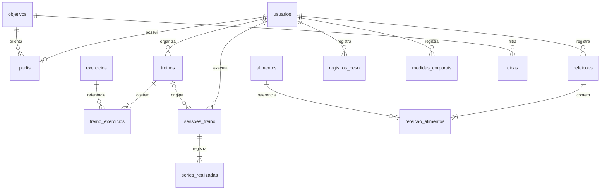

# Banco de dados

Schema MySQL 8+ com InnoDB, chaves estrangeiras e CHECK constraints. Aplicação e conexão usam UTF-8 (`utf8mb4`). Importe schema e seed em um banco vazio. Nenhuma conta de usuário é criada pelo seed.

| Tabela | Responsabilidade |
|---|---|
| usuarios | Nome, email único e hash de senha |
| objetivos | Três objetivos disponíveis |
| perfis | Perfil 1:1 do usuário e objetivo |
| exercicios | Catálogo compartilhado de movimentos |
| treinos | Planos do usuário e dias (array JSON de 0–6) |
| treino_exercicios | Exercícios do plano, ordem, séries, carga e descanso |
| sessoes_treino | Execuções reais, início, término e nome histórico |
| series_realizadas | Snapshot dos exercícios e parâmetros por série |
| alimentos | Catálogo verificado e valores por 100 g |
| refeicoes | Refeições do usuário por data |
| refeicao_alimentos | Associação com quantidade em gramas |
| dicas | Conteúdo por objetivo e fonte |
| registros_peso | Um registro por usuário/data |
| medidas_corporais | Cintura, quadril e braço por usuário/data |
| tentativas_login | Hashes de IP/email e timestamp de autenticação |

## Relacionamentos e exclusões

Usuário → perfil, planos, sessões, refeições, peso e medidas em CASCADE. Plano → exercícios em CASCADE; plano → sessões em SET NULL, preservando nomes e séries já realizadas. Sessão → séries e refeição → itens em CASCADE. Catálogos e objetivos são protegidos por suas referências (sem cascata destrutiva).

Índices cobrem email, propriedade dos planos, sessões por usuário/data, refeições por usuário/data, busca de alimento e janela de rate limiting. Peso/medidas possuem índices únicos compostos. Quantidades usam DECIMAL para persistência. Os limites também são validados no backend.

## Catálogo alimentar

IDs originais da TACO: 3, 163, 164, 182, 469, 488, 561, 567 e 577. Cada linha inclui fonte, energia (kcal), proteínas, carboidratos e gorduras (g) por 100 g de parte comestível. O modo de preparação faz parte do nome e deve ser respeitado. Valores são médias e não reproduzem necessariamente receitas do usuário.

Para acrescentar alimentos, consulte a publicação e documente ID, preparação, edição e unidades. Não altere valores de alimentos existentes sem considerar o impacto nos registros que os referenciam.

## Transações

Salvar plano/refeição, iniciar sessão e atualizar peso usam transações. Início de sessão bloqueia a linha do usuário para impedir duas sessões simultâneas. Atualizações de série e finalização bloqueiam a sessão para impedir alterações após o término.

Os dias da semana são armazenados como um pequeno array JSON em `treinos`, validado no servidor. Os demais relacionamentos de múltiplos itens usam tabelas associativas.

## Produção

Use o hostname Aiven e o certificado CA em caminho absoluto fora do diretório público. Faça backups e teste a restauração. O instalador inicial exige banco vazio e não oferece migrações. O schema foi executado tanto no MariaDB 10.4 local quanto no MySQL 8.4.11 do Aiven. A conexão ao Aiven foi validada com certificado CA e TLS. A configuração usa valores locais à requisição, evitando interferência entre chamadas simultâneas no Apache.
